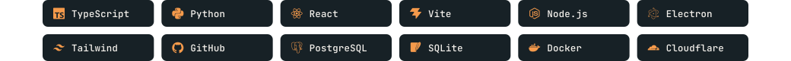

<!-- Artwork is generated: run `python3 design/build_assets.py` to refresh the contribution count. -->

  <a href="https://ache.lol">
    <picture>
      <source media="(prefers-color-scheme: dark) and (max-width: 1100px)" srcset="assets/hero-dark-narrow.svg">
      <source media="(prefers-color-scheme: light) and (max-width: 1100px)" srcset="assets/hero-light-narrow.svg">
      <source media="(prefers-color-scheme: dark)" srcset="assets/hero-dark.svg">
      
    </picture>
  </a>

## Ache

Ache is an AI workspace: chat with your codebase, edit files, and preview the running app in one window.

  

**[Start free →](https://ache.lol/signup)** · [Desktop](https://ache.lol/desktop) · [Docs](https://ache.lol/docs) 
Free to start, no card · OpenAI/Anthropic-compatible API · 480 models · zero-data-retention on eligible models

## Also built

- **LocalOwl** — self-hosted AI code review for GitHub PRs, on your local LLM · [source](https://github.com/EOSKILLZ/LocalOwl)
- **Pulse** — Discord bot that peaked at **100K+ users** · retired
- **YAP.REST** — link-in-bio platform that peaked at **~500 users** · retired

## Tools I build with

  <picture>
    <source media="(prefers-color-scheme: dark) and (max-width: 1100px)" srcset="assets/badges-dark-narrow.svg">
    <source media="(prefers-color-scheme: light) and (max-width: 1100px)" srcset="assets/badges-light-narrow.svg">
    <source media="(prefers-color-scheme: dark)" srcset="assets/badges-dark.svg">
    
  </picture>

  <picture>
    <source media="(prefers-color-scheme: dark) and (max-width: 1100px)" srcset="assets/contributions-dark-narrow.svg">
    <source media="(prefers-color-scheme: light) and (max-width: 1100px)" srcset="assets/contributions-light-narrow.svg">
    <source media="(prefers-color-scheme: dark)" srcset="assets/contributions-dark.svg">
    
  </picture>

  <a href="https://virex.dev/commissions/submit"><b>Work with me via Virex →</b></a>

