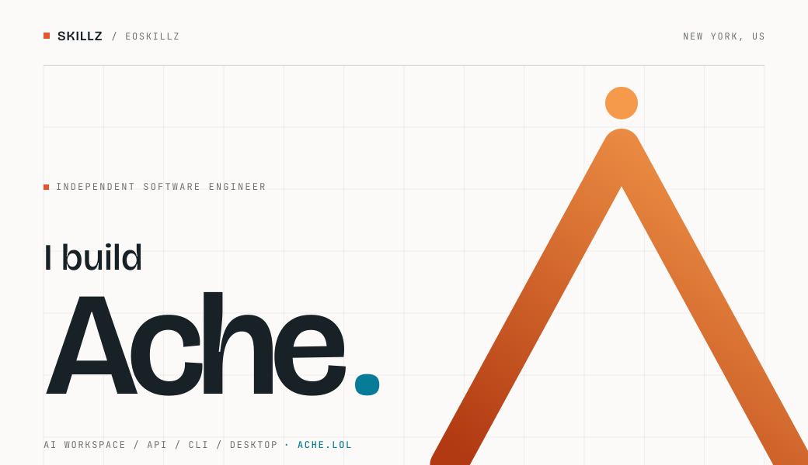
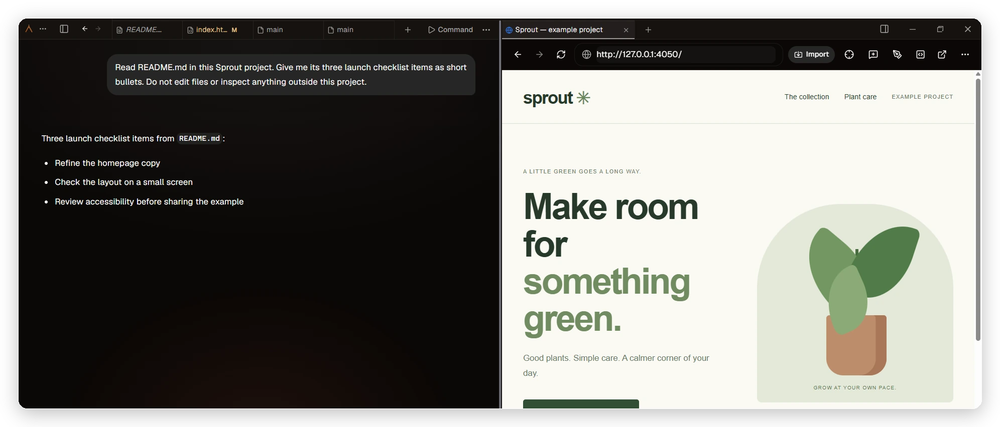
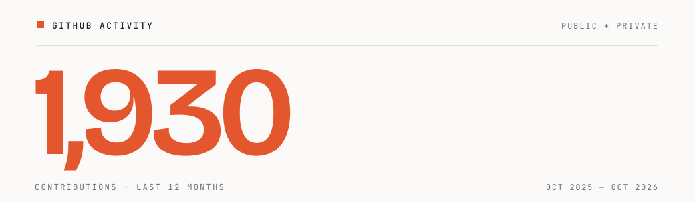

<!-- Artwork is generated: run `python3 design/build_assets.py` to refresh the contribution count. -->

  <a href="https://ache.lol">
    <picture>
      <source media="(prefers-color-scheme: dark)" srcset="assets/hero-dark.svg">
      <source media="(prefers-color-scheme: light)" srcset="assets/hero-light.svg">
      
    </picture>
  </a>

## Ache

My AI workspace: chat with your codebase, edit files, and preview the running app in one window.

  

Conversation, files, and the live app in one window.

**[Start free →](https://ache.lol/signup)** · [Desktop](https://ache.lol/desktop) · [Docs](https://ache.lol/docs) 
Free to start, no card · OpenAI/Anthropic-compatible API · 480 models · BYOK · zero-data-retention routing on eligible models

## Tools I build with

  
  
  
  
  
  
  
  
  
  
  
  

## Also built

- **LocalOwl** — self-hosted AI code review for GitHub PRs, on your local LLM · [source](https://github.com/EOSKILLZ/LocalOwl)
- **Pulse** — Discord bot that reached **100K+ users** · retired
- **YAP.REST** — link-in-bio platform that reached **300+ users** · retired

  <picture>
    <source media="(prefers-color-scheme: dark)" srcset="assets/contributions-dark.svg">
    <source media="(prefers-color-scheme: light)" srcset="assets/contributions-light.svg">
    
  </picture>

  <a href="https://virex.dev/commissions/submit"><b>Open to select commissions →</b></a>

